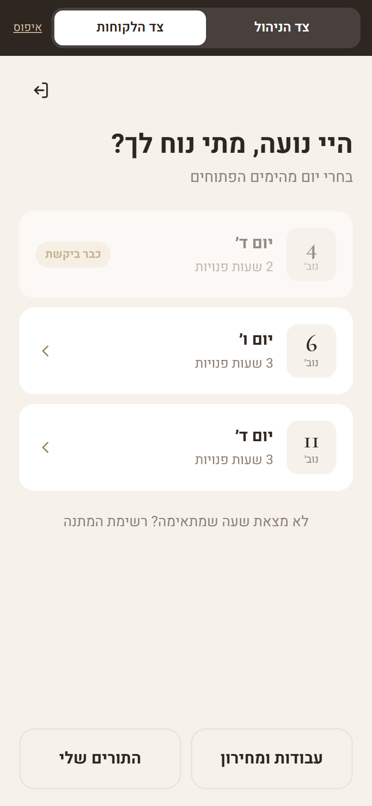
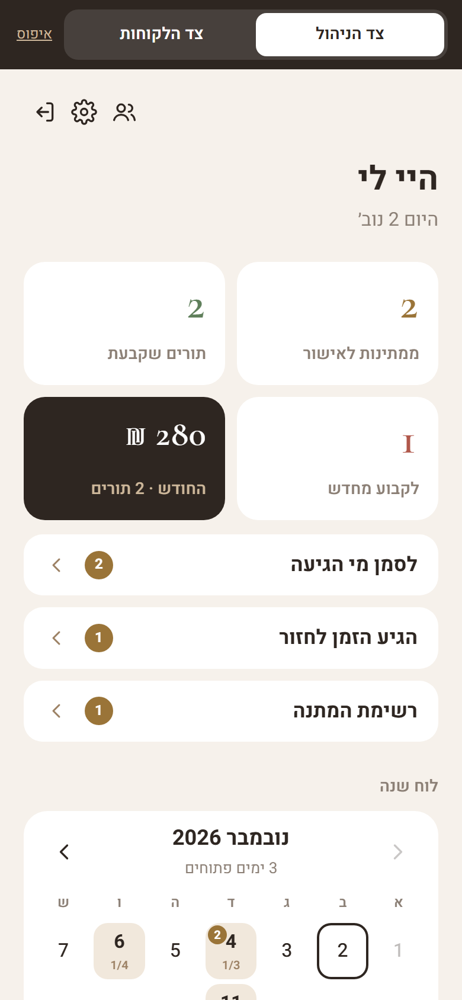

# Nails by Lee

A booking system I built for Lee, a nail technician working from home. Clients ask for a time from their phone. Lee approves, reschedules or declines, and keeps track of her clients and her month, all from her own phone.

Before this, everything happened in WhatsApp threads: "do you have something Tuesday?", back and forth, and a paper notebook to remember who's coming when.

The interface is in Hebrew (right-to-left) and built for phones first.

| Client: welcome | Client: booking | Lee: home |
| --- | --- | --- |
|  |  |  |

**Demo:** the web app runs on its own, with sample data, when it's built without an API address. A switch at the top moves between Lee's side and the client side, so you can book as a client and then approve it as Lee.

## What it does

**For clients**
- Sign in with name and phone number (no passwords to forget)
- Pick a day and time from what Lee opened, then the treatment and extras, with the price as they go
- See their upcoming appointments, cancel up to N hours before (Lee sets N)
- Join a waitlist when nothing fits
- Gallery of Lee's work and the price list

**For Lee**
- Requests waiting for approval; approve, decline or offer another time
- Warns when she's about to approve two clients for the same slot
- Month calendar: open days and set the hours for each
- Book a client by hand (for people who still call)
- Client cards with history, notes, visits, money spent, cancellations and no-shows
- "Time to come back": regulars whose last visit was over three weeks ago with nothing booked
- Ready-made WhatsApp messages (confirmation, new time, "a spot opened up") that open in WhatsApp for her to send
- This month's income by treatment
- Edit prices and extras, upload photos, choose whether requests need approval

## How it's built

```
core/     booking rules: one function, (state, request) -> response. No I/O.
web/      React + TypeScript (Vite). Talks to the API, or runs core/ in the browser for the demo.
server/   Express + SQLite (node:sqlite). Runs the same core/ behind real auth.
```

The interesting decision is **`core/handler.ts`**. All of the rules (which slots are free, who can cancel when, what counts toward this month's income, who is due for a visit) live in one pure function with no database or HTTP in it. The server wraps it with authentication and persistence. The demo wraps it with localStorage. Both run exactly the same rules, and the tests exercise them directly without starting anything.

**Server details**
- **Logins are signed tokens** (HMAC-SHA256 with an expiry), so a client can't change her id or make herself an admin. The admin password comes from an environment variable and is compared in constant time. Admin login is limited to 5 attempts per 15 minutes per IP.
- **Writes are all-or-nothing.** The handler runs on a copy of the state, and the copy replaces the live state only after SQLite has saved it.
- **Storage is one JSON document in SQLite.** One technician with a few hundred bookings a year comes to a few hundred KB. That gives atomic saves and a single file to back up, with no ORM or migrations. If it ever outgrows that, the handler's state shape maps directly to tables.
- **Times are Israel time** wherever the server runs, so "can she still cancel?" doesn't depend on the host's time zone.

## Running it

Node 22.13 or newer.

```bash
# demo: the web app alone, on sample data
cd web && npm install && npm run dev

# real setup
cd server && npm install
cp .env.example .env            # set ADMIN_PASSWORD and SESSION_SECRET
cd ../web && npm install && npm run build:server
cd ../server && npm start       # clients at /, Lee at /admin
```

Tests (booking rules, tokens, storage): `cd server && npm test`

## Bugs found while porting it

The first version was a single-file prototype. Turning it into this project, with types and tests, turned up a few real bugs:
- Approving a second client for a slot that was already approved was possible.
- A day that only had a manual booking couldn't be opened for clients: it was refused with "this day is already open", even though it wasn't.
- A failed approval still moved the screen on as if it had worked.
- In SQLite, the database connection was released by garbage collection while prepared statements still pointed at it ("statement has been finalized"). `server/src/store.test.ts` reproduces it with `--expose-gc`.
